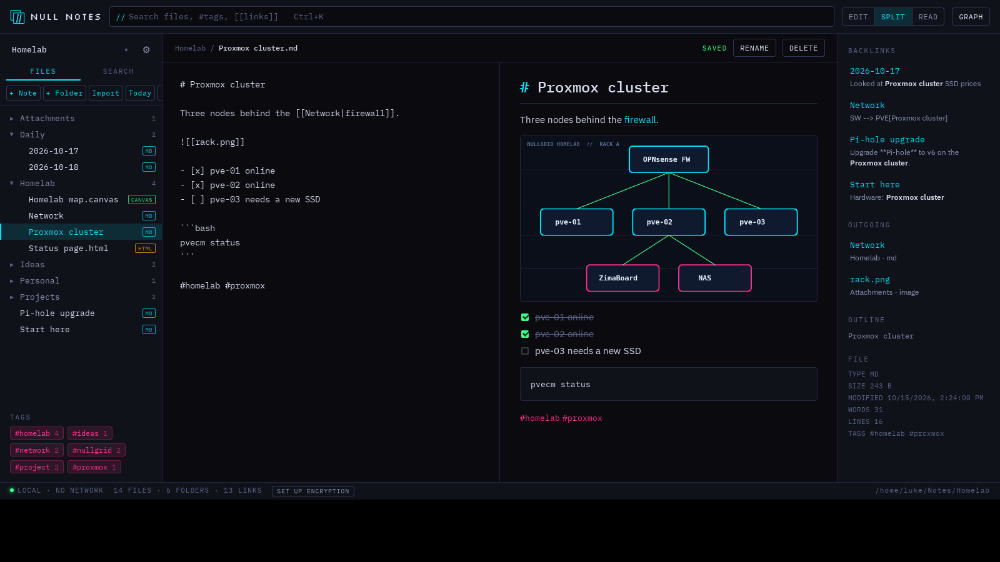
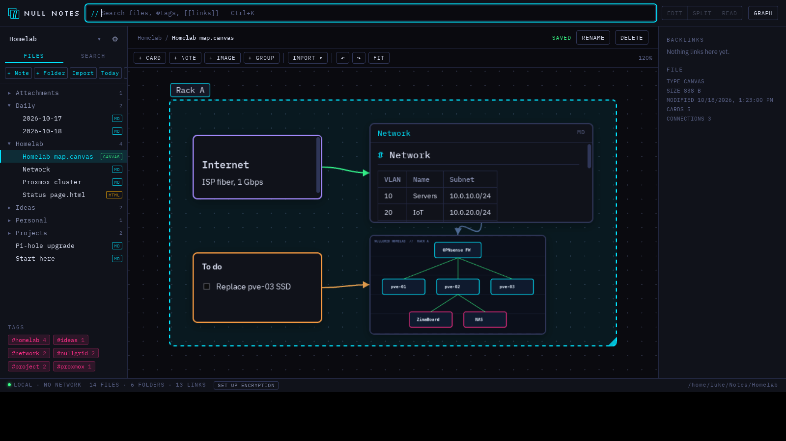
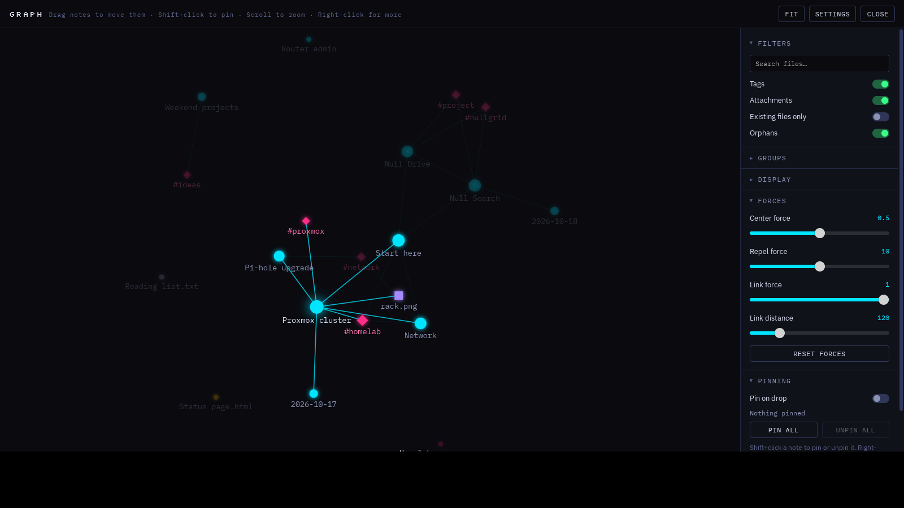
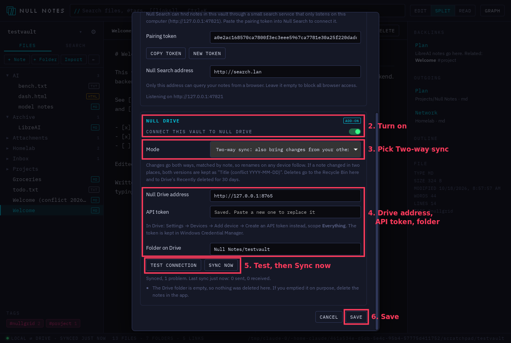

# Null Notes

**Your notes, as plain files. Linked, searchable, encrypted, synced.**

Null Notes is a local-first Markdown notes app for Windows and Linux. A vault is just a folder on your computer: no account, no cloud, nothing leaves the machine unless you turn on sync. It's part of **[Null Grid](https://nullgrid.dev)**, alongside Null Search and Null Drive.



## Features

- **Markdown with a live preview.** Tasks, tables, code, images and Mermaid diagrams. Edit, Split or Read view.
- **`[[Wiki links]]` and `#tags`.** Backlinks, an outline, and links that update when you rename a note.
- **More than Markdown:**
  - plain-text notes;
  - sandboxed HTML pages;
  - **canvases**: whiteboards in the JSON Canvas format, which Obsidian also uses.
- **Graph view** of how notes connect (Ctrl+G).
- **Find anything:** Ctrl+K quick open, plus full-text search with matching lines.
- **Daily notes** (Ctrl+D), with templates.
- **Locked notes.** XChaCha20-Poly1305 with an Argon2id key. Their text never touches the disk unencrypted.
- **Sync with [Null Drive](https://nullgrid.dev), your own file server.**
  - One-way backup or two-way sync, matched by note id so renames follow.
  - Conflicts keep both copies; nothing is ever silently overwritten.
  - **End-to-end encrypted Drive accounts are supported (5.0):** names and contents are encrypted on your computer before they're sent.
- **Null Search integration.** A private search service on `127.0.0.1` lets Null Search find your notes, and `nullnotes://open?id=…` links open them in the app.

| Canvas | Graph |
|---|---|
|  |  |

## Install

- **Windows:** [Microsoft Store](https://apps.microsoft.com/detail/9NW82T0G35QF), or the installer from [Releases](../../releases).
- **Linux:** download from [Releases](../../releases), for **x86_64** or **ARM64** (`aarch64`/`arm64` in the file name). Every package works on distros from 2022 on (glibc 2.35+, WebKitGTK 4.1).

  | Distro | File | How |
  |---|---|---|
  | Any, without installing | `Null-Notes-5.1.0-x86_64.AppImage` | `chmod +x Null-Notes-*.AppImage`, then run it |
  | Any, sandboxed | `null-notes-5.1.0-x86_64.flatpak` | `flatpak install ./null-notes-5.1.0-x86_64.flatpak` (needs the [Flathub remote](https://flathub.org/setup)) |
  | Any with snapd | `null-notes_5.1.0_amd64.snap` | `sudo snap install --dangerous ./null-notes_5.1.0_amd64.snap` |
  | Ubuntu 22.04+, Debian 12+, Mint, Raspberry Pi OS | `null-notes_5.1.0_amd64.deb` | `sudo apt install ./null-notes_5.1.0_amd64.deb` |
  | Fedora, openSUSE | `null-notes-5.1.0-1.x86_64.rpm` | `sudo dnf install ./null-notes-5.1.0-1.x86_64.rpm` (openSUSE: `sudo zypper install ./…`) |
  | Arch, Manjaro, EndeavourOS | AUR: `null-notes-bin` | `yay -S null-notes-bin`, or build the attached `PKGBUILD` with `makepkg -si` |
  | Anything else | `null-notes-5.1.0-linux-x86_64.tar.gz` | unpack, then `./null-notes`, or `./install.sh` to add it to your app menu (no sudo) |

  Check a download with `sha256sum -c SHA256SUMS --ignore-missing`.

## Sync with Null Drive



1. Open Settings (⚙ next to the vault name), then the **Null Drive** section.
2. Turn on **Connect this vault to Null Drive** and choose **Two-way sync**, or **Back up** for one way.
3. Enter your Drive address and an API token. In Drive: Settings → Devices → Add device → Create an API token instead, with the **Everything** scope.
4. **If your Drive account is end-to-end encrypted:** click Test connection, then unlock with your **E2EE passphrase** or recovery key. That's the passphrase from Drive's encryption setup, not your Drive login. You only do this once per computer.
5. Save. New and changed notes sync within seconds.

`http://` addresses are only accepted on this computer or your local network: `10.x`, `172.16–31.x`, `192.168.x`, `*.lan`, `*.local`. Anything else needs `https://`.

## Build from source

The app is Tauri 2: a Rust backend in `src-tauri/`, and a plain HTML/JS frontend in `src/` with no build step.

```bash
# Linux: sudo apt install libwebkit2gtk-4.1-dev libssl-dev build-essential
cd src-tauri
cargo test --lib                      # backend tests (sync, encryption, search, links…)
cargo install tauri-cli --version "^2"
cargo tauri dev                       # run it
cargo tauri build                     # Windows: NSIS + MSI installers
```

**Packages:**
- **Linux (AppImage, .rpm, .tar.gz, .deb):** `packaging/linux/build-linux.sh`, on the architecture you're building for. Build on the oldest distro you want to support: a binary needs a glibc at least as new as the build machine's.
- **Flatpak:** `packaging/flatpak/` (manifest `dev.nullgrid.notes.yml`; run `cargo-sources.sh` first).
- **Snap:** `packaging/snap/snapcraft.yaml`, made from the .deb.
- **AUR:** `packaging/aur/make-aur.sh` writes `PKGBUILD` and `.SRCINFO` from the release tarballs.
- **Microsoft Store:**
  - on Windows, `packaging/msix/build-msix.ps1`;
  - or cross-built from Linux, `packaging/msix/build-msix-linux.sh`.

Pushing a tag like `5.0.1` or `v5.0.1` runs [the release workflow](.github/workflows/release.yml), which builds all of them and attaches them to the GitHub release. For a tag that already exists: Actions → Release → Run workflow.

**Try sync without a Drive server:**
- **Plain account:** `python3 tools/mock_drive.py 8765 mytoken`
- **End-to-end encrypted account:** `python3 tools/mock_drive_e2ee.py 8766 mytoken`, unlocked with passphrase `vector passphrase 123`.

## Repository layout

| Path | What |
|---|---|
| `src/` | the frontend: editor, preview, canvas, graph, settings |
| `src-tauri/src/` | the backend: vault and files, locked notes (`lock.rs`), note ids, search index + local agent (`index.rs`, `agent.rs`), links, Null Drive backup and sync (`backup.rs`, `sync.rs`, `syncplan.rs`), Drive end-to-end encryption (`e2ee.rs`) |
| `src-tauri/testdata/e2ee/` | Null Drive's encryption test vectors |
| `packaging/` | Linux packages (AppImage, .deb, .rpm, .tar.gz, Flatpak, Snap, AUR) and Microsoft Store (MSIX) |
| `tools/` | Drive stand-ins for testing, and Drive's reference encryption client |
| `docs/HISTORY.md` | how each feature works, phase by phase |
| `docs/handoffs/` | handoff notes for the Null Grid apps |

## Security

See [SECURITY.md](SECURITY.md) for what's encrypted where, and how to report a problem.

## License

Copyright © NULLGRID. All rights reserved. See [LICENSE](LICENSE).
